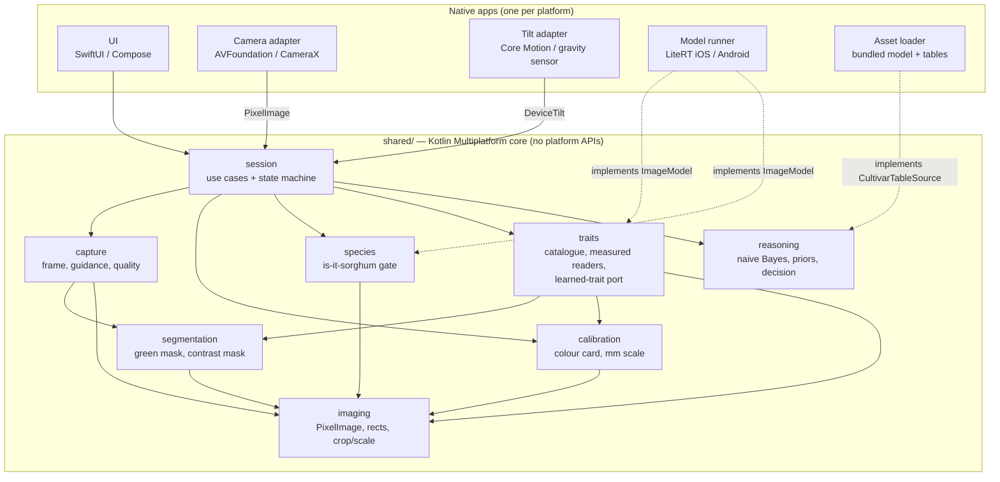
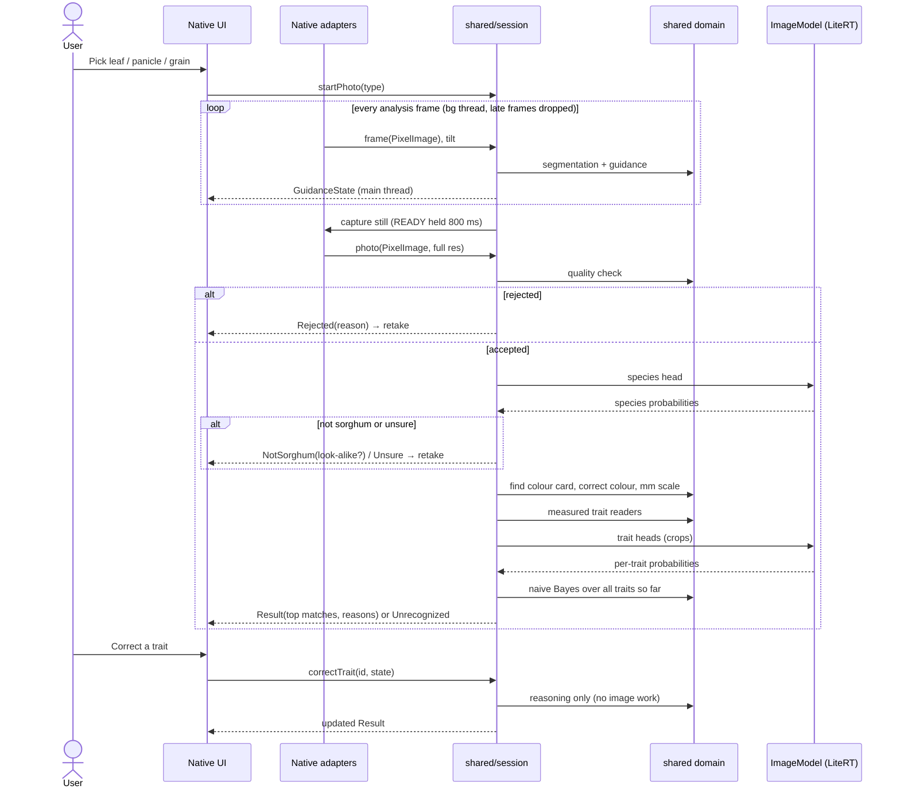

# Sorghum Cultivar Identification — Architecture

Status: proposed, 2026-10-19. Source design: *Sorghum Cultivar Identification: Theory and Prior Work* (Claude Doc, 2026-10-03).
Decisions are recorded in [`adr/`](adr/). Phase 1 (capture + quality check) is built on Android, and the live green check also runs on iPhone (`ios/`); everything else here is target design.

**Platforms:** iPhone and Android, with the same features and the same answers. iOS is the lead platform for new work; Android follows from the same shared core.

## 1. Summary

The app identifies a sorghum cultivar **offline, on the phone**, in three steps:

0. **Check it is sorghum** with a small image classifier (MobileNetV3-Small species head). Non-sorghum samples stop here with "not sorghum" ([ADR-0006](adr/0006-species-gate-before-cultivar.md)).
1. **Read visible traits** from guided photos of a leaf, panicle or grain sample on a plain board with a colour card. Each trait is a standard IBPGR/ICRISAT descriptor and comes out as a **probability over its states**.
2. **Reason over traits** with a naive Bayes network whose tables come from genebank data (Genesys), and return the best matches with the traits that drove them, or "unrecognized".

One **Kotlin Multiplatform (KMP) core** (`shared/`) holds all logic. Thin native apps (`androidApp/`, `iosApp/`) provide UI, camera, motion sensors and model execution. `model/` builds one `.tflite` model and the cultivar tables that both apps ship.

## 2. Drivers

| Driver | Source | Consequence for the architecture |
| --- | --- | --- |
| Fully offline; photos never leave the device | Phase 1 overview §6 | No network layer at all. All data (model, tables) is bundled and versioned with the app. |
| Research project, free, non-commercial | Product owner, 2026-10-19 | Training data and tables may use CC BY, BY-NC, BY-SA and BY-NC-SA sources (not ND or unlicensed). Every shipped model and table records its sources and licences; SA tables ship under CC BY-SA. Going commercial would require removing NC data and retraining. See `reports/Sorghum identification datasets.md`. |
| Android and iPhone | Design doc, "Cross-platform solution" | Logic shared once in KMP; only platform I/O is native. |
| Scales to many cultivars and covers cultivars with no photos | Design doc, "Goal" | Trait-first pipeline; cultivar knowledge is data (tables), not model weights ([ADR-0001](adr/0001-trait-first-identification.md)). |
| Explainable, correctable results | Design doc, "Reasoning layer" | Reasoning takes trait distributions as plain data, so a user correction re-runs only reasoning. |
| Same photo → same answer on both platforms | Design doc, caveats | One implementation of every rule; parity tests on shared fixtures; one model file. |
| Live guidance must keep up with the camera | Phase 1 | Analysis on small frames, off the main thread, late frames dropped. |

**Assumptions** (unverified, flagged in §9): Kotlin/Native pixel loops are fast enough on iPhone for 160 px live frames; a ColorChecker-style card can be placed on every board; Genesys accessions can be mapped to the named cultivars users need.

## 3. Structure



Arrows are compile-time dependencies. Dotted arrows are native implementations of interfaces (ports) that `shared/` defines.

### 3.1 Layers and dependency rules

| Layer | Lives in | Knows about | Must not know about |
| --- | --- | --- | --- |
| **Presentation** | `androidApp/ui`, `iosApp/UI` | `session` public API, its state types | Pixels, thresholds, probabilities math |
| **Platform adapters** | `androidApp/platform`, `iosApp/Platform` | OS APIs; converts to/from shared boundary types | Domain rules (no thresholds, no trait logic) |
| **Application** | `shared/session` | All domain modules; ports | Any OS API |
| **Domain** | `shared/{capture,species,calibration,segmentation,traits,reasoning}` | `imaging`, each other per the graph above | `session`, UI, OS APIs |
| **Foundation** | `shared/imaging` | Kotlin stdlib only | Everything else |

Rules:

1. Dependencies point **down** the table and **inward** to `shared/`. Nothing in `shared/` imports Android, UIKit, AVFoundation, CameraX or LiteRT.
2. **`reasoning` never sees pixels.** Its only input is trait distributions + tables + priors. This is what makes correction and cultivar-table updates cheap.
3. Native code calls **only `session`** (plus boundary types). If UI needs something, `session` exposes it.
4. Every external capability that differs per platform is a **port** (Kotlin interface) in `shared/`, implemented natively and injected at startup: `ImageModel` (one LiteRT model, many heads), `CultivarTableSource`. No `expect/actual` for domain behaviour.
5. No cycles between domain modules. `capture` and `traits` both use `segmentation`; neither depends on the other.

### 3.2 Module responsibilities

| Module | Owns | Exists today as |
| --- | --- | --- |
| `imaging` | `PixelImage(width, height, rgb: ByteArray)`, `NormalizedRect`, `PixelRect`, crop/downscale/rotate on `PixelImage` | `imaging/ImageRects.kt` (rect types); Bitmap code in `camera/FrameCropper.kt` to be replaced |
| `capture` | Target frame, frame mapping, tilt → guidance state, steady-hold timer, photo quality check | `frame/`, `guidance/`, `quality/` |
| `segmentation` | Plant mask by excess-green (leaves); background-contrast mask vs plain board (panicles, grain); sample coverage + edge touch | `sample/GreenCoverage.kt`; contrast mask is new |
| `species` | Map the model's species head to `SpeciesEstimate` (sorghum / named look-alike / other plant / no plant); decide continue, "not sorghum", or "unsure — retake" against a calibrated threshold from model metadata | New (ADR-0006) |
| `calibration` | Find colour card (ColorChecker Classic Mini in a board slot), fit affine colour correction in linear sRGB to known patch values, pixels-per-mm from patch pitch ([ADR-0008](adr/0008-colour-card-choice.md)) | `shared/calibration/` (PlantCV affine method, linear light) |
| `traits` | Trait catalogue (descriptor id, states, photo type, method); `TraitEstimate` (distribution over states, or value + uncertainty for continuous traits); measured readers (midrib colour, pigmentation, glume colour, grain colour, lustre, seed size); mapping of `ImageModel` trait heads to `TraitEstimate` | New |
| `reasoning` | `CultivarTable` (P(state \| cultivar) per trait, with noise floor), priors, naive Bayes posterior, decision (top-k, "unrecognized" when fit is poor), explanation (traits that moved the ranking most) | New |
| `session` | Use cases and state: start session → pick photo type → live guidance → capture → check → calibrate → read traits → accumulate across photos → reason → correct trait → re-reason | Capture flow in `shared/session/CaptureFlow.kt` (step 2); Android `CaptureViewModel` and iOS `CaptureModel` adapt it |

### 3.3 Boundary contracts

These cross the KMP ↔ native boundary or the model boundary. Keep them plain data so Swift sees simple types through the Objective-C bridge ([ADR-0003](adr/0003-plain-pixel-boundary.md)).

| Contract | Shape | Notes |
| --- | --- | --- |
| `PixelImage` | width, height, row-major RGB bytes, upright | Native adapters convert from `CVPixelBuffer` / `ImageProxy`. One copy per frame; live frames are ≤160 px long side, photos are downscaled per use (640 px quality check, full res crops for awns). |
| Target region | `NormalizedRect` in upright-image fractions | Shared computes it; native maps preview ↔ image (AVFoundation `metadataOutputRect…`, CameraX viewport). |
| `DeviceTilt` | pitch°, roll°; 0/0 = flat, screen up | Same convention as phase 1. |
| `ImageModel` | uint8 input tensor built by `shared/` → every output tensor as floats, by output index (species now, traits later) | Preprocessing spec (size, crop, quantization) lives in `model/` metadata and is applied in `shared/`, not in native code; `shared/` maps outputs to heads by `outputIndex`. |
| `CultivarTableSource` | → `CultivarTables` (versioned JSON bytes parsed in `shared/`) | Native only reads the bundled file; parsing and validation are shared. |
| `SessionState` | Sealed hierarchy exposed to UI | Swift consumes via SKIE (sealed → enum) or flat state fields. |

Units: lengths in **mm**; colours inside `shared/` in **corrected linear sRGB 0–1** after calibration; probabilities always sum to 1 per trait.

## 4. Runtime view

### 4.1 Main flow



### 4.2 Threads

- Live analysis: native camera queue → `shared` pure functions → result posted to main. Late frames dropped (`alwaysDiscardsLateVideoFrames` / `STRATEGY_KEEP_ONLY_LATEST`).
- Post-capture pipeline (quality → calibration → traits → reasoning): one background coroutine per photo in `session`; UI shows progress. Model inference runs on the same worker.
- Reasoning after a correction is cheap (cultivars × traits × states multiply-adds) and may run on the main thread.

### 4.3 Failure paths

| Failure | Behaviour |
| --- | --- |
| Photo blurry / dark / glare / no sample | Reject with specific reason; retake (phase 1 behaviour). |
| Species gate says not sorghum | Stop; show "not sorghum" and the look-alike name if confident. No cultivar result. |
| Species gate unsure (below threshold) | Ask for a retake or another photo type; never pass an unsure sample to cultivar matching. |
| Colour card not found | Reject with reason "colour card not visible". Measured colour traits are meaningless without correction. *(Our call; alternative is to continue with colour traits disabled.)* |
| Model file missing or fails to load | Session starts in "measured traits only" mode and says so; learned traits are absent, not guessed. |
| Cultivar tables invalid (schema/version) | Fail at startup with a clear error; never run reasoning on partial tables. |
| Best match explains traits poorly | Return "unrecognized" plus the group of compatible cultivars. |
| Several cultivars share the observed trait profile | Return them as a group (DUS-style), not a forced single pick. |

## 5. Data and model assets

| Asset | Produced by | Shipped as | Versioning |
| --- | --- | --- | --- |
| Trait model | `model/` training (MobileNetV3-Small backbone, per-trait heads), INT8 post-training quantization | `traits-vN.tflite` + `traits-vN.json` (input spec, trait ids, state order, calibration temps) | Model and metadata share N; `shared/` refuses a mismatched trait catalogue. |
| Cultivar tables | `model/` scripts from Genesys ICRISAT characterization data (CC BY-SA) + noise floor | `cultivars-vN.json` | Schema version + data version; attribution kept in file. |
| Test fixtures | `model/` | `shared/src/commonTest/resources` | Same images + expected trait outputs used by Android and iOS parity tests. |

## 6. Deployment view

- `shared/` builds to an Android library (consumed by `androidApp`) and an XCFramework (consumed by `iosApp` via Xcode build phase or SwiftPM binary target).
- Each app bundles the same model and table files. No server, no updates over the network; new data ships with an app release.
- Android keeps the phase 1 manifest rule: no `INTERNET` permission. iOS: no networking frameworks, no analytics SDKs.

### 6.1 iOS app (`iosApp/`)

| Concern | iOS implementation | Shared core does |
| --- | --- | --- |
| Shared logic | `Shared.xcframework` built by Gradle (`assembleSharedXCFramework`) in an Xcode Run Script phase before compiling Swift; SKIE for Swift-friendly sealed classes and `suspend`/`Flow` | Everything in §3.2 |
| UI | SwiftUI; renders `SessionState`, forwards user events | Owns the state machine |
| Camera | AVFoundation (`AVCaptureSession`, BGRA video output for live frames, `AVCapturePhotoOutput` for stills), pinch zoom; reuses today's `ios/` camera code | Target frame, guidance, quality |
| Frame → `PixelImage` | One converter: crop to target region via `metadataOutputRectConverted`, downscale, BGRA → RGB, rotate upright | Takes `PixelImage` only |
| Tilt | Core Motion `CMDeviceMotion.gravity` → pitch/roll in the shared convention | Guidance from `DeviceTilt` |
| Model (`ImageModel`) | LiteRT for iOS (Swift API) running the same `.tflite`; Core ML or Metal delegate optional, chosen only if the parity test still passes | Preprocessing, species and trait decisions |
| Assets | Model, model metadata and cultivar tables in the app bundle; read as bytes and passed to shared | Parses and validates them |
| Privacy | `NSCameraUsageDescription` only; no network entitlement use, no analytics SDKs | — |
| Target | iPhone, iOS 17+, portrait | — |
| Tests | XCTest for the converter and adapters; shared logic tested once in `commonTest` and run on the iOS simulator target (`iosSimulatorArm64Test`) | Parity fixtures |

## 7. Repository layout (target)

```text
/
├── shared/                 # KMP core
│   └── src/
│       ├── commonMain/kotlin/com/sorghum/
│       │   ├── imaging/  capture/  segmentation/  calibration/
│       │   ├── traits/   reasoning/  session/
│       └── commonTest/     # all domain + parity tests
├── androidApp/             # Compose UI, CameraX, sensors, LiteRT adapter
├── iosApp/                 # SwiftUI UI, AVFoundation, Core Motion, LiteRT adapter
├── model/                  # training, export, table builder, fixtures
└── docs/architecture/      # this file + ADRs
```

## 8. Migration from today

Today: pure logic (`frame/ guidance/ quality/ sample/`, `session/CaptureFlow`) in `shared/` (steps 1-2), consumed by the Android app in `app/` and the iOS app in `ios/` through `Shared.framework` (step 3; the R3 device benchmark is still open).

1. **Create `shared/`** and move the pure packages unchanged (`frame`, `guidance`, `quality`, `sample`), replacing `Bitmap`/`Float` platform touch points with `PixelImage`. Move their JVM tests to `commonTest`. Android app depends on `shared/`; behaviour unchanged.
2. **Move session logic** out of `CaptureViewModel` into `shared/session`; Android ViewModel becomes a thin adapter.
3. **iOS on shared:** `iosApp/` consumes the XCFramework; delete the Swift ports of `GreenCoverage`, `TargetFrame`, `SampleStatus` ([ADR-0005](adr/0005-swift-port-is-temporary.md)). Keep the Swift camera, preview and pinch-zoom code as the iOS adapter. Benchmark live analysis on a real iPhone before deleting the port.
4. **Species gate:** `model/` trains MobileNetV3-Small with a species head; `ImageModel` implemented with LiteRT on iOS first, then Android; `shared/species` decides. First user-visible identification on iPhone: "sorghum / not sorghum".
5. **Calibration** (colour card + mm scale), then **contrast mask** for panicle/grain.
6. **Measured traits + reasoning** with a first Genesys table — first cultivar result.
7. **Learned traits** as extra heads on the same backbone, one at a time.

Steps 1–3 change no user-visible behaviour and should land before new features.

## 9. Risks

| # | Risk | Severity | Mitigation / experiment |
| --- | --- | --- | --- |
| R1 | Many cultivars share the same visible trait profile, capping accuracy | High | Count distinct profiles in Genesys before building traits (open question in design doc); design results as groups. |
| R2 | Genesys holds accessions, not the named cultivars users ask for | High | Agree the target cultivar list and its accession mapping before table building. |
| R3 | Kotlin/Native pixel loops or ObjC bridge copies too slow on iPhone | Medium | Step 3 benchmark: green coverage at 160 px must finish < 5 ms/frame on the oldest target iPhone; if not, keep that one hot loop native behind a port. |
| R4 | Naive Bayes overconfident (traits from one photo share errors) | Medium | Calibrate on held-out photos; temperature-scale learned traits; noise floor in tables. |
| R5 | Phone colour after card correction doesn't match descriptor colour states | Medium | Measure card-corrected colours of reference samples early (step 4). |
| R6 | Too few labelled photos per learned trait | Medium | Start with measured traits only (step 5); add learned traits one at a time, each gated by held-out accuracy. |
| R7 | Quantization or preprocessing differs between platforms | Low–Med | Preprocessing only in `shared/`; parity test runs the same fixtures through both LiteRT runtimes. |
| R8 | Scope growth: iOS was out of scope in phase 1 | Low | Migration steps 1–3 are behaviour-neutral and can ship independently. |

## 10. Open questions

- Species gate input: the board photos (leaf/panicle/grain) or a separate whole-plant photo? Which look-alikes are named classes (maize, pearl millet, sugarcane, Johnson grass)?
- Which named cultivars and regions does v1 target? (sets priors, tables, R1/R2)
- Leaf-only early-season mode: useful given leaves carry ~3 traits?
- Oldest iPhone / Android device to support? (sets R3 budget; iOS floor is iOS 17 today)
- ~~LiteRT on iOS: CocoaPods or Swift Package Manager?~~ Decided: CocoaPods, TensorFlowLiteSwift 2.17.0 ([ADR-0007](adr/0007-litert-ios-via-cocoapods.md)).
- Is a colour card on every board acceptable to users in the field?
